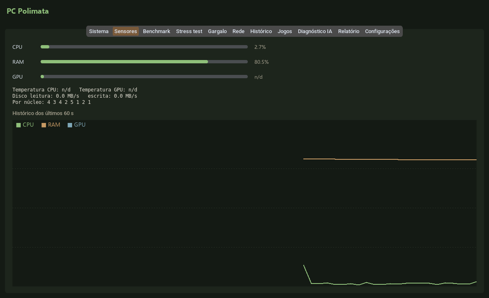
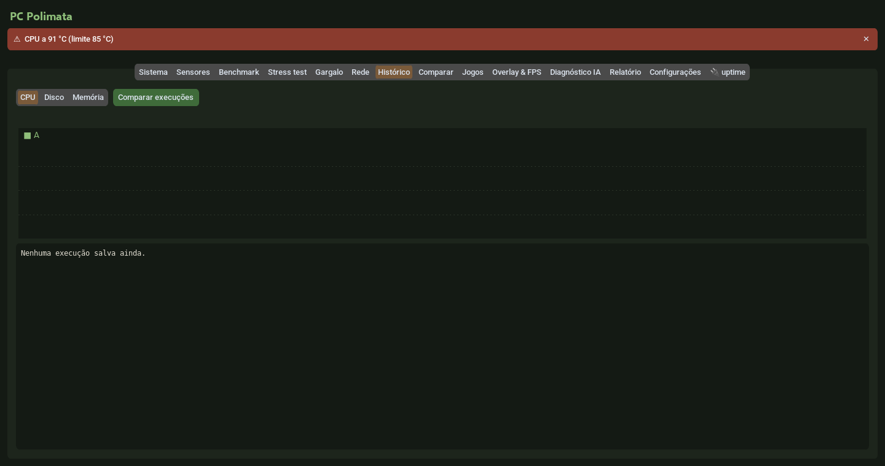
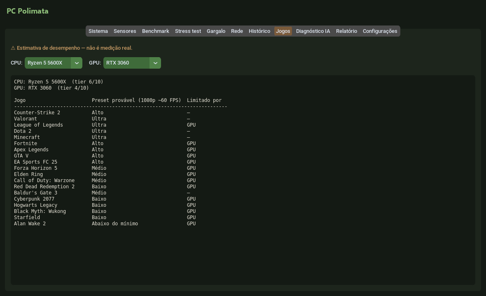
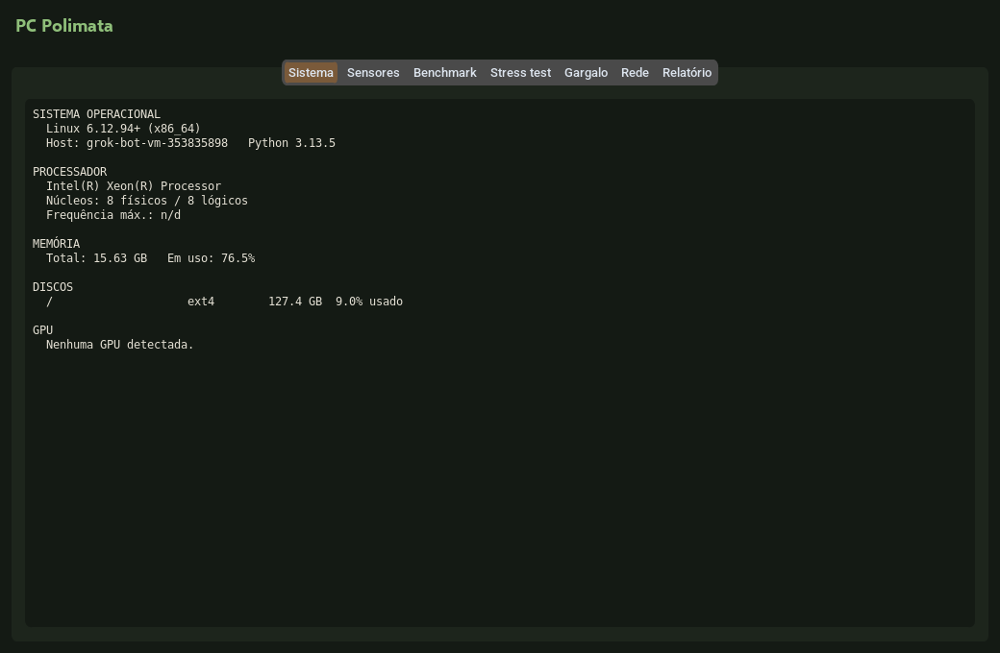
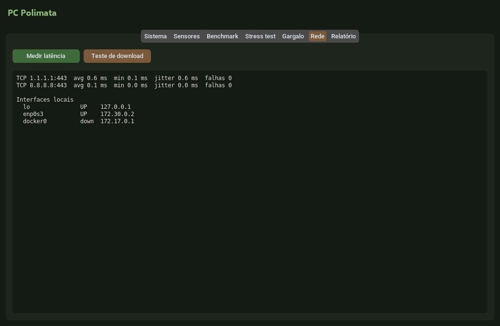
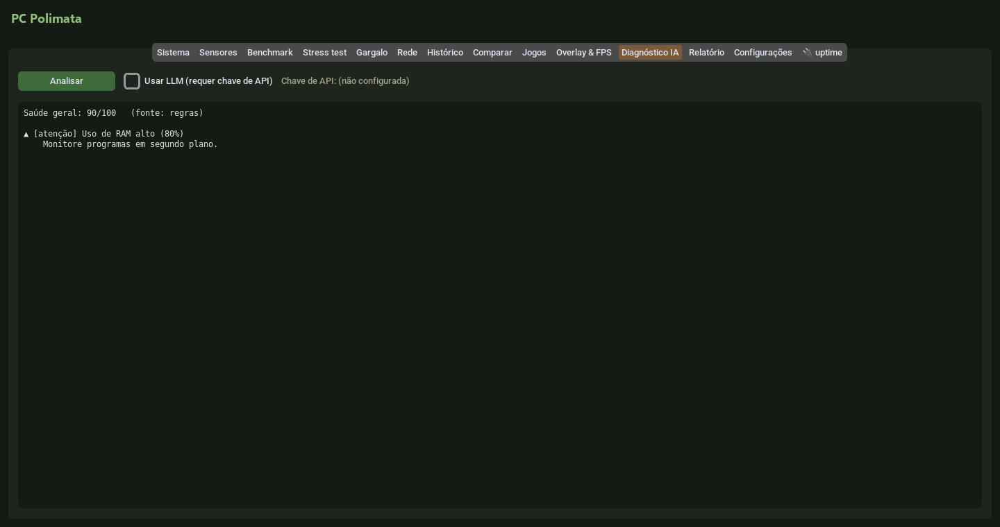
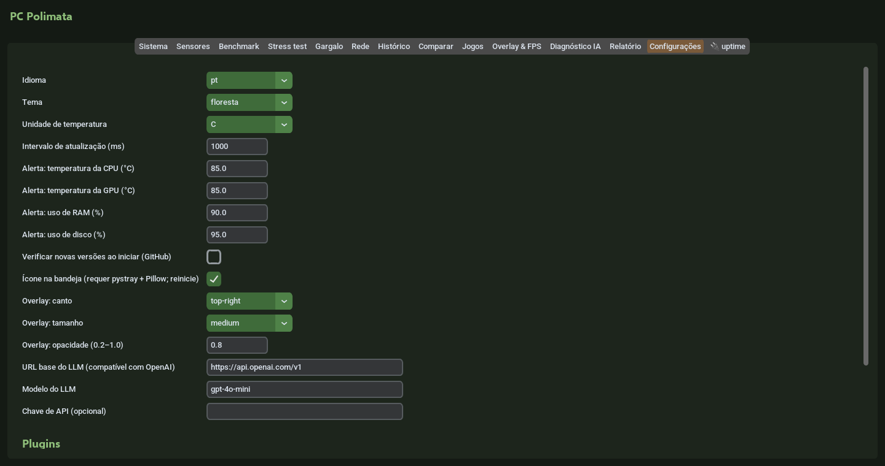

# PC Polimata

[](https://github.com/ThomasRhoden/pc-polimata/releases)


Aplicativo desktop de **diagnóstico, monitoramento e benchmark de hardware**, escrito do zero em Python.
Inspirado na proposta de ferramentas como AIDA64, CPU-Z, GPU-Z e Cinebench — **nenhum código dessas
ferramentas foi copiado ou descompilado**; todos os algoritmos e scores são próprios.



## Funcionalidades

| Aba | O que faz |
|-----|-----------|
| **Sistema** | SO, CPU, RAM, discos e GPUs (NVIDIA, AMD, Intel) + **saúde SMART** dos discos (smartctl) |
| **Sensores** | Uso de CPU (total e por núcleo), RAM, disco (MB/s) e GPU em tempo real, temperaturas e **gráfico dos últimos 60 s** |
| **Benchmark** | Score single/multi-core (`multiprocessing`), disco (leitura/escrita MB/s) e **memória** (largura de banda e latência) |
| **Stress test** | Carga em todos os núcleos com duração, limite de temperatura e botão de parada segura |
| **Gargalo** | Amostra 30/45/60 s durante uma carga real e indica se CPU ou GPU é o limitante |
| **Rede** | Latência TCP a 1.1.1.1 e 8.8.8.8 (sem admin), interfaces locais e teste de download com timeout |
| **Histórico** | Toda execução de benchmark salva em **SQLite**; comparação com a anterior e gráfico de evolução |
| **Jogos** | **Estimativa** do preset provável em 19 jogos populares a partir de tiers de CPU/GPU (não é medição) |
| **Diagnóstico IA** | Regras offline com nota de saúde 0–100 e dicas; análise opcional por **LLM** (API compatível com OpenAI) |
| **Relatório** | Exporta tudo para JSON ou HTML |
| **Configurações** | Idioma PT/EN, tema, °C/°F, intervalo de atualização, endpoint/modelo/chave do LLM |

<table>
<tr><td></td><td></td></tr>
<tr><td></td><td></td></tr>
<tr><td></td><td></td></tr>
</table>

### Suporte de hardware

| Recurso | Windows | Linux |
|---------|---------|-------|
| Temperatura CPU | LibreHardwareMonitor/OpenHardwareMonitor em execução (WMI) | `psutil` (coretemp, k10temp...) |
| GPU NVIDIA (uso, VRAM, temp.) | NVML / GPUtil | NVML / GPUtil |
| GPU AMD | nome + VRAM (WMI); temp. via LibreHardwareMonitor | sysfs `amdgpu` ou `rocm-smi` (uso, VRAM, temp.) |
| GPU Intel | nome (WMI) | — |
| SMART | `smartctl` (smartmontools) como administrador | `smartctl` como root |

### CLI (headless)

```bash
pc-polimata --report                                   # JSON no stdout
pc-polimata --report -o relatorio.html                 # HTML
pc-polimata --benchmark --memory --duration 3          # benchmarks (salvos no histórico)
pc-polimata --smart --games --diagnose -o r.json       # SMART, jogos e diagnóstico por regras
pc-polimata --diagnose --llm                           # + análise por LLM (requer chave)
```

`python -m pc_polimata ...` funciona igual, sem instalar.

## Arquitetura

O núcleo (`pc_polimata/core`) não depende da GUI: é testado sem display e reutilizado pela CLI.
Diagramas completos em [docs/ARCHITECTURE.md](docs/ARCHITECTURE.md).

```
pc_polimata/
├── core/                 # lógica pura, testada com pytest
│   ├── system_info.py    # coleta estática (psutil, py-cpuinfo)
│   ├── gpu.py            # NVML -> GPUtil -> sysfs AMD -> rocm-smi -> WMI
│   ├── windows_temps.py  # LibreHardwareMonitor/OpenHardwareMonitor via WMI
│   ├── sensors.py        # snapshots de uso/temperatura
│   ├── timeseries.py     # janela deslizante + coordenadas de gráfico
│   ├── benchmark.py      # CPU (primos + float, Pool spawn) e disco
│   ├── memory_bench.py   # largura de banda e latência da RAM
│   ├── stress.py         # stress test com limites e parada segura
│   ├── bottleneck.py     # heurística CPU x GPU
│   ├── network.py        # latência TCP, interfaces, throughput
│   ├── smart.py          # smartctl -j
│   ├── history.py        # SQLite + comparação de execuções
│   ├── games.py          # tiers de CPU/GPU -> preset estimado
│   ├── diagnosis.py      # regras + LLM opcional
│   ├── settings.py       # preferências em JSON no diretório de config do SO
│   ├── secrets.py        # chave de API (env var ou arquivo 0600)
│   └── report.py         # JSON / HTML
├── data/hardware_tiers.json
├── gui/                  # customtkinter: app.py, widgets.py (LineChart em Canvas), tabs/
├── i18n.py               # PT (padrão) / EN
└── cli.py
```

Princípios: **degradação graciosa** (todo backend opcional vira "n/d" se faltar), **injeção de
dependências** para testar rede, WMI, sysfs, smartctl e LLM sem hardware real, e **multiprocessing**
para carga de CPU (contorna o GIL).

## Como executar

Requer Python 3.10+ (Windows principal, Linux suportado).

```bash
# como ferramenta
pipx install git+https://github.com/ThomasRhoden/pc-polimata.git
pc-polimata

# ou a partir do código
git clone https://github.com/ThomasRhoden/pc-polimata.git && cd pc-polimata
python -m venv .venv
.venv\Scripts\activate          # Windows  (Linux: source .venv/bin/activate)
pip install -r requirements.txt
python -m pc_polimata
```

- Linux: a GUI precisa do Tk do sistema (`sudo apt install python3-tk`).
- Temperaturas no Windows: abra o [LibreHardwareMonitor](https://github.com/LibreHardwareMonitor/LibreHardwareMonitor)
  como administrador e `pip install wmi`.
- LLM: defina `PC_POLIMATA_API_KEY` (ou `OPENAI_API_KEY`) ou informe a chave na aba Configurações. Qualquer
  endpoint compatível com OpenAI funciona (ex.: Ollama em `http://localhost:11434/v1`).
- Executável Windows (.exe) e pipx: ver [docs/BUILD.md](docs/BUILD.md).

Testes e lint:

```bash
pip install -e ".[dev]"
ruff check . && pytest
xvfb-run -a pytest tests/test_gui_smoke.py   # smoke test da GUI no Linux sem monitor
```

## Privacidade

Tudo roda localmente. Só há tráfego de rede quando você usa a aba Rede (conexões TCP e download de
teste da Cloudflare) ou o diagnóstico por LLM (o relatório, sem hostname, vai ao endpoint configurado).
Configurações, histórico e chave ficam no diretório de configuração do usuário
(`%APPDATA%\PCPolimata` ou `~/.config/pc-polimata`).

## Limitações conhecidas

- **GPU**: telemetria completa em NVIDIA e AMD no Linux. No Windows, GPUs AMD/Intel mostram nome e VRAM; uso fica "n/d" ([#9](https://github.com/ThomasRhoden/pc-polimata/issues/9)).
- **Temperatura no Windows** depende do LibreHardwareMonitor aberto; sem ele aparece "n/d" (com uma dica) e o limite de temperatura do stress test fica inativo.
- **Scores** de CPU/memória são próprios do PC Polimata e não comparáveis a Cinebench/AIDA64. A latência de memória medida em Python inclui overhead do interpretador (é um teto).
- **Leitura de disco** pode ser inflada pelo cache do SO.
- **Gargalo** e **Jogos** são heurísticas/estimativas, não medem FPS.
- **Latência** é o tempo de `connect()` TCP, não ICMP; proxies/VPNs transparentes podem distorcer o valor.
- **SMART** exige smartmontools e privilégios de administrador/root.

## Desenvolvido com auxílio de IA

Este projeto foi construído com **assistência de IA**. Uso IA como ferramenta para acelerar o
desenvolvimento (estrutura, rascunhos de código e testes), mas revisei, executei e validei o
resultado — e sou responsável pelas decisões de arquitetura e pelo código publicado.

## Roadmap

Itens abertos nas [issues](https://github.com/ThomasRhoden/pc-polimata/issues); histórico no
[CHANGELOG](CHANGELOG.md). Contribuições: [CONTRIBUTING.md](CONTRIBUTING.md).

---

## English

**PC Polimata** is a from-scratch Python desktop app for hardware diagnostics, monitoring and benchmarking,
inspired by tools such as AIDA64, CPU-Z, GPU-Z and Cinebench (no code from them was copied or decompiled).

**Features:** system info with SMART disk health; live sensors with 60 s charts; CPU (single/multi-core),
disk and memory benchmarks; stress test with temperature limit and safe stop; CPU-vs-GPU bottleneck
heuristic; network tab (TCP latency, interfaces, download test); SQLite benchmark history with run
comparison; game performance **estimates** from CPU/GPU tiers; health diagnosis with offline rules and an
optional LLM (any OpenAI-compatible API); JSON/HTML reports; settings with PT/EN UI. Headless CLI included
(`pc-polimata --report`, `--benchmark`, `--memory`, `--smart`, `--games`, `--diagnose [--llm]`).

**Architecture:** GUI-free `pc_polimata/core` (pytest-covered, dependency-injected for hardware/network
fakes) + `customtkinter` GUI + `argparse` CLI. Every optional backend degrades gracefully to "n/a".
See [docs/ARCHITECTURE.md](docs/ARCHITECTURE.md).

**Run:** `pipx install git+https://github.com/ThomasRhoden/pc-polimata.git && pc-polimata`, or
`pip install -r requirements.txt && python -m pc_polimata`. Tests: `ruff check . && pytest`.
Windows .exe build: [docs/BUILD.md](docs/BUILD.md).

**Hardware support:** NVIDIA via NVML/GPUtil, AMD on Linux via sysfs/rocm-smi, GPU names on Windows via WMI;
Windows temperatures require LibreHardwareMonitor running; SMART requires smartctl with admin/root.

**Limitations:** scores are PC Polimata-specific; game estimates and bottleneck analysis are heuristics;
latency is TCP-connect time.

**AI assistance:** built with AI assistance — I use AI to speed up development, and I reviewed,
ran and validated the code myself.

License: MIT.
