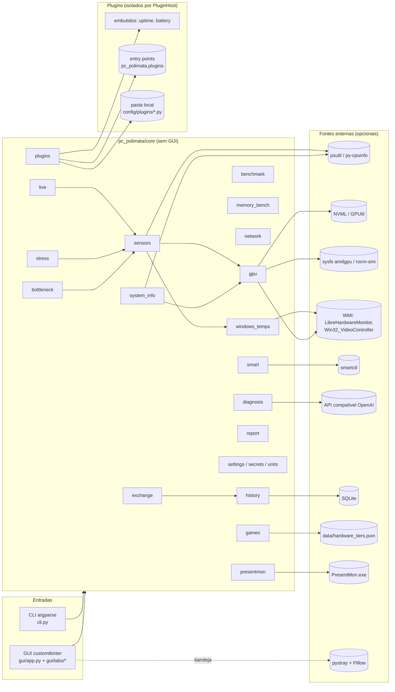
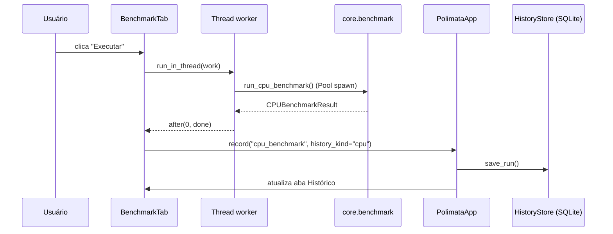

# Arquitetura

O PC Polimata separa **lógica de domínio** (`pc_polimata/core`), **interface gráfica**
(`pc_polimata/gui`) e **CLI** (`pc_polimata/cli.py`). O `core` não importa nada da GUI, então é
testado com pytest sem display e reutilizado pela CLI.

## Princípios

- **Degradação graciosa**: todo backend opcional (NVML, WMI, rocm-smi, smartctl, numpy, LLM) é
  tentado dentro de `try` e, se falhar, o valor vira `None`/"n/d". O app nunca quebra por falta de hardware
  ou dependência.
- **Injeção de dependências para testes**: rede (`opener`, `connect`), relógio, `wmi`, `smartctl`
  (`runner`), transporte HTTP do LLM e raiz do sysfs são parâmetros, então os testes usam fakes e fixtures.
- **Concorrência**: carga de CPU usa `multiprocessing` com `spawn` (contorna o GIL e é seguro com threads).
  A GUI executa trabalho em threads e só atualiza widgets na thread principal via `after()`.
- **Dados do usuário** ficam fora do repositório, no diretório de config do SO: `settings.json`,
  `history.sqlite3` e `api_key` (permissão 0600).

## Fluxo de um benchmark na GUI

